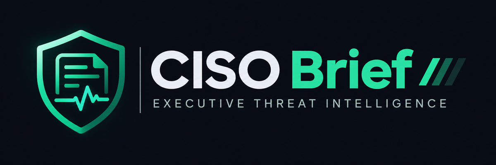
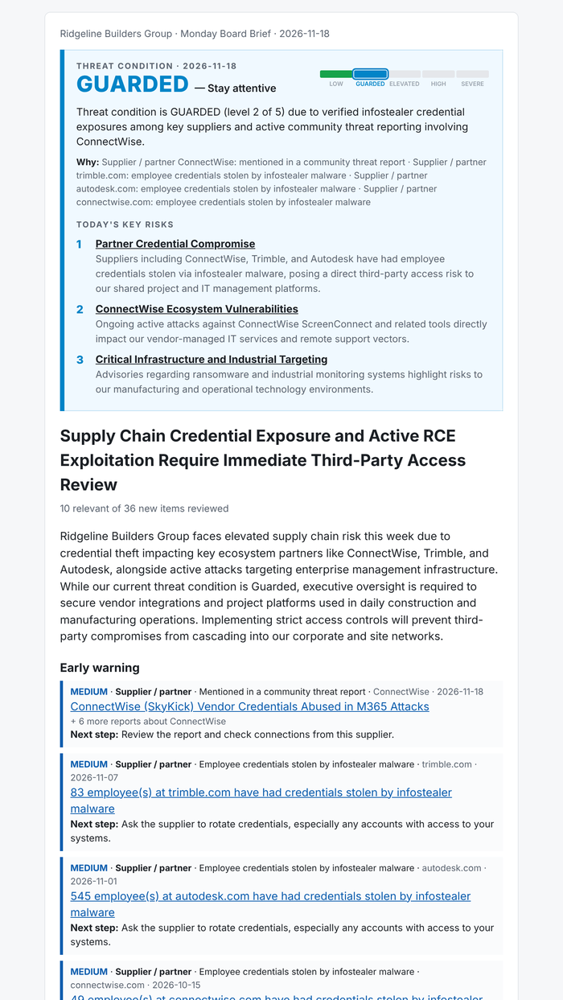
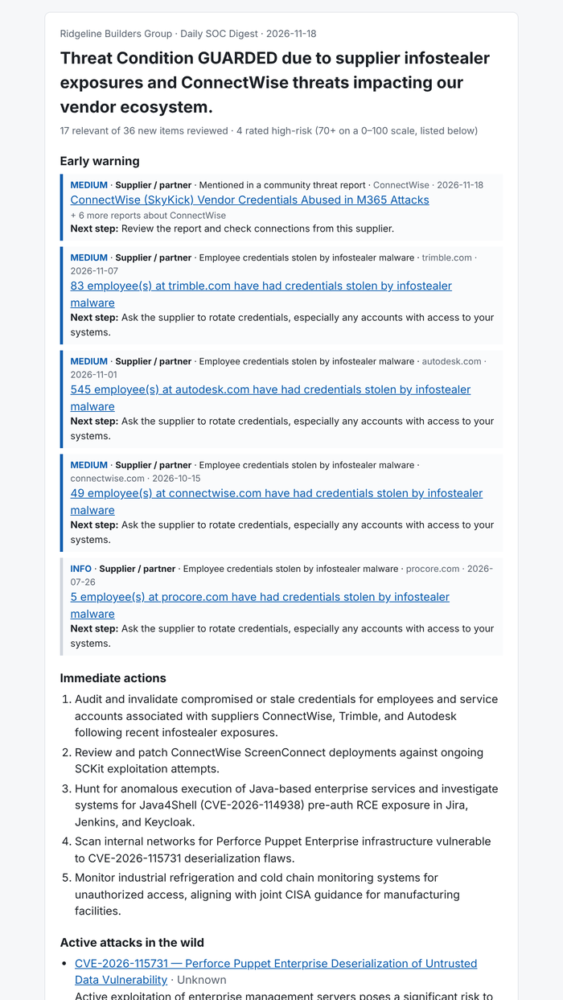
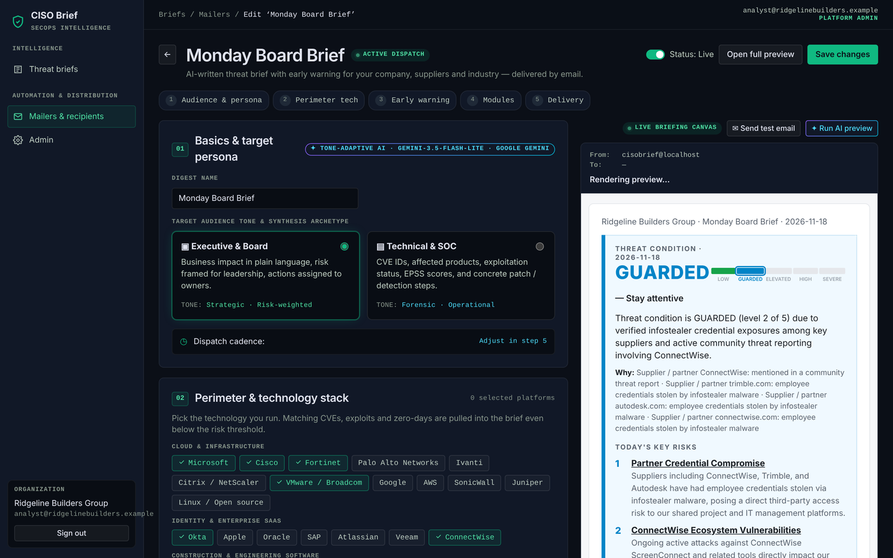
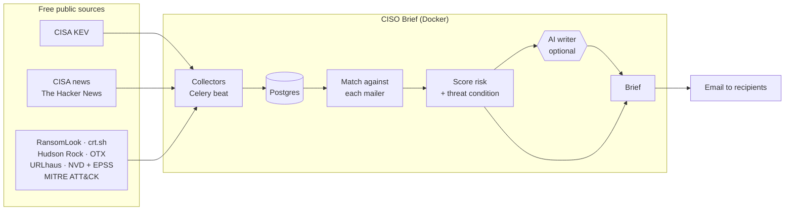

<div align="center">



<p><b>A free, self-hosted threat-intel briefing that lands in your inbox, written for the people who read it.</b></p>

<p>
Pick your technology, your suppliers and your industry. CISO Brief watches free public sources,<br>
works out what matters to <i>you</i>, and emails a brief on your schedule: board-level or SOC-level.
</p>

<p>


</p>

<p>
<a href="#what-you-get">What you get</a> ·
<a href="#how-it-works">How it works</a> ·
<a href="#two-ways-to-run-it">Docker or Claude skill</a> ·
<a href="#install-guide">Install</a> ·
<a href="INSTALL_WITH_AI.md">AI-assisted install</a> ·
<a href="#7-add-free-api-keys-optional-recommended">API keys</a> ·
<a href="#email">Email</a> ·
<a href="#early-warning-sources">Sources</a>
</p>

</div>

---

## Why it exists

Most threat-intel feeds are a firehose: hundreds of items a day, most of them irrelevant to any one company.
Security leaders end up re-reading the same news to answer two questions: **how worried should we be today, and what do we do about it?**

CISO Brief answers both in the email itself. The website is only where you set up and preview the brief; **everything the reader needs is in the email**.

<table>
<tr>
<td width="50%" valign="top">

**For the board and executives**

- A **threat condition** from LOW to SEVERE at the top of every brief, with plain-language reasons
- **Today's key risks**, ranked, each with why it matters to the business
- Business impact in plain language, with no CVE soup

</td>
<td width="50%" valign="top">

**For the SOC and engineers**

- CVEs, affected products, CISA KEV status, EPSS exploit likelihood
- Early-warning hits on your domains and your suppliers
- Concrete patch, hunt and detection steps

</td>
</tr>
</table>

## What you get

<table>
<tr>
<td width="50%" valign="top" align="center">
<b>Monday Board Brief</b> (Executive tone)<br><br>

</td>
<td width="50%" valign="top" align="center">
<b>Daily SOC Digest</b> (Technical tone)<br><br>

</td>
</tr>
</table>

<sub>Both samples come from the built-in demo company, <i>Ridgeline Builders Group</i>, a fictional construction firm. Its supplier watchlist uses real vendors, so the early-warning hits come from real public reporting.</sub>

### Build each brief in the mailer builder

Every organization can run several **mailers**, for example a Monday board brief and a daily SOC digest. Each one has its own:

| Setting | What it controls |
|---|---|
| **Audience** | Executive/Board or Technical/SOC; changes the tone, depth and wording the AI uses |
| **Technology stack** | Vendors and products you run (Microsoft, Fortinet, Okta, Procore, …) plus your own "Other" entries |
| **Industries** | Sector-specific reporting and the threat groups known to target it (MITRE ATT&CK) |
| **Watchlist** | Your company names and domains, and your key suppliers and partners |
| **Keywords and actors** | Anything else you want flagged |
| **Modules** | Which sections appear and in what order (drag to reorder) |
| **Filters** | Minimum risk score, "actively exploited only", sources, item count |
| **Delivery** | Schedule, timezone and recipients |

The live canvas on the right shows the exact email as you change settings. **Run AI preview** writes it for real, and **Send test email** mails the preview to you alone.

<p align="center">

</p>

## How it works



1. **Collect.** Background workers pull CISA KEV and security news every 4 hours, and the early-warning sources every 6 to 24 hours.
2. **Match.** Each item is matched to each mailer on whole words and whole domains (vendors, products, keywords, actors, your domains and your suppliers' domains), so "Okta" never matches "Oktoberfest".
3. **Score.** Items get a 0 to 100 risk score from KEV status, EPSS exploit likelihood and severity. Early-warning hits are ranked critical, high, medium or info by **whose name is on them**: yours, a supplier's, your industry's or a vendor's.
4. **Set the threat condition.** A transparent rules engine sets the level. The AI never picks the level; it only explains it.

   | Level | Triggered by | Posture |
   |---|---|---|
   | 🟢 **LOW** | Nothing below applies | Routine monitoring |
   | 🔵 **GUARDED** | High-risk items in the feeds, or medium signals about you or your suppliers | Stay attentive |
   | 🟡 **ELEVATED** | A supplier on a leak site or hosting malware, an exploited item matching your industry or keywords, or 3+ new KEV entries | Heightened vigilance |
   | 🟠 **HIGH** | A high-severity signal about your company (lookalike domain, fresh infostealer hits, a threat report naming you), active exploitation in your own stack, or a vendor CVE ≥50% likely to be exploited | Act today |
   | 🔴 **SEVERE** | Your company is named on a ransomware leak site, or your domain is serving malware | Respond now |

5. **Write.** If AI is on, it writes the headline, summary, key risks, themes and actions in the tone of the mailer's audience. If it's off or unavailable, the brief still goes out with rules-based key risks, and the email says so honestly.
6. **Deliver.** The brief is emailed on the mailer's own schedule and timezone. A critical early-warning hit adds **[Action needed]** to the subject line.

## Two ways to run it

| | **Docker app** | **Claude skill** |
|---|---|---|
| What you install | Docker; 7 small containers | Nothing but a folder (needs a paid Claude plan) |
| Settings | Web mailer builder with live preview | One commented file, `ciso-brief.ini` (Claude can fill it in by asking you) |
| Scheduling | Built in | A Claude scheduled task ("run my CISO Brief every weekday at 7am") |
| Writing | Optional AI: local, free tier or paid | Claude writes it |
| Email | Any SMTP server | **Optional**: Gmail/Outlook connector (draft or send), SMTP, or just show it in chat |
| API-key sources | `.env` | `[keys]` in the settings file, or environment variables; each one optional |
| Best for | Teams, several mailers, no AI vendor | One person or team that already uses Claude |

Both use the same sources, the same matching and the same LOW-to-SEVERE rules, so they reach the same threat condition.

<details>
<summary><b>Set up the Claude skill</b></summary>

The skill lives in [`claude-skill/ciso-brief/`](claude-skill/ciso-brief/).

1. **Add it to Claude.**
   - **Claude (web or desktop app):** download [`claude-skill/ciso-brief.zip`](claude-skill/ciso-brief.zip) and upload it under Skills in Claude's settings.
   - **Claude Code:** copy the folder to `~/.claude/skills/ciso-brief/`.
2. **Ask:** *"Set up my CISO Brief."* Claude asks for your company, domains, industry, technology, suppliers and audience, and writes `ciso-brief.ini` for you. Or copy `config.example.ini` to `ciso-brief.ini` and fill it in yourself.
3. **Optional keys:** add free OTX, abuse.ch and NVD keys under `[keys]` (or as `CISO_BRIEF_OTX_API_KEY`, `CISO_BRIEF_ABUSECH_AUTH_KEY`, `CISO_BRIEF_NVD_API_KEY`). Blank keys simply skip that source, and the brief says which ones were skipped. See [step 7](#7-add-free-api-keys-optional-recommended) for where to get them.
4. **Optional email:** set `[delivery] mode = email`, then either `email_method = connector` (Claude drafts or sends through your Gmail/Outlook connector) or `email_method = smtp` (fill in `[smtp]`). Leave `mode = chat` to just get the brief in the conversation.
5. **Run it:** *"Run my CISO Brief."* To schedule: *"Run my CISO Brief every weekday at 7am."*

How it works: `scripts/collect.py` (standard-library Python, nothing to install) fetches the sources and sets the threat condition by fixed rules; Claude writes the narrative; `scripts/render.py` builds the email. If Claude's environment blocks some sites, Claude fetches them with its own web tools and hands the findings back to the script, so the rules still decide the level. Sources needing API keys in headers (OTX, URLhaus) are skipped in that case. Where Claude has normal internet access (Claude Code, or the desktop app working in a folder on your computer), every source works.

Keep `ciso-brief.ini` private: it can hold API keys and an email password.
</details>

## Install guide

> **Prefer to have an AI do it?** Give [`INSTALL_WITH_AI.md`](INSTALL_WITH_AI.md) to Claude, ChatGPT or any assistant that can run commands. It walks you through every step below, checks each one, and fixes common problems.

### 1. What you need

| | Minimum | Notes |
|---|---|---|
| **Docker** | Docker Desktop (Windows / macOS) or Docker Engine + Compose plugin (Linux) | [Get Docker](https://docs.docker.com/get-started/get-docker/). On Windows, use the WSL 2 backend. |
| **Memory** | 2 GB free RAM | 8 GB+ and ideally a GPU if you run the local AI (Ollama) |
| **Disk** | 2 GB | Another ~5 GB for the local AI model |
| **Ports** | 80, 8025 free on this machine | Everything binds to `127.0.0.1` only, so nothing is exposed to your network |
| **Git** | any | Or download the ZIP from GitHub |

### 2. Download

```bash
git clone https://github.com/eineEule/CISOBrief.git
cd CISOBrief
```

### 3. Create your settings file

```bash
cp .env.example .env          # Windows PowerShell: Copy-Item .env.example .env
```

Open `.env` in a text editor and set these two values. Everything else can stay as it is for a first run.

| Setting | What to put |
|---|---|
| `POSTGRES_PASSWORD` | Any long password; you never type it again |
| `DJANGO_SECRET_KEY` | A long random string. Generate one with:<br>`docker run --rm python:3.12-alpine python -c "import secrets; print(secrets.token_urlsafe(50))"` |

> `.env` holds your secrets and is git-ignored. Never commit it or paste its contents anywhere public.

### 4. Start it

```bash
docker compose up -d --build
docker compose ps             # wait until web, worker, beat, db, redis, nginx, mailpit are "running"
```

The first build takes a few minutes. The web container sets up the database automatically.

### 5. Create your account

1. Go to **http://localhost/accounts/signup/**. Enter your email, a password, your organization name, its domain and your industry.
2. Open **http://localhost:8025** (Mailpit) and click the confirmation link. In this default setup every email lands in Mailpit, so nothing leaves your machine.
3. Sign in. Your organization gets a starter mailer.

Optional:

```bash
# Load the demo company (Ridgeline Builders Group) with a Board brief and a SOC digest, built right away
docker compose exec web python manage.py seed_demo --now --email you@example.com

# Admin account for http://localhost/admin
docker compose exec web python manage.py createsuperuser
```

### 6. Build your first brief

Open **Mailers → New mailer**. Choose the audience, tick the technology you run, add your domains and key suppliers, pick modules, and set the schedule and recipients. The preview on the right updates as you go. Use **Run AI preview** to see the written version and **Send test email** to mail it to yourself. Save, then **Send now** from the mailer list to get one immediately.

### 7. Add free API keys (optional, recommended)

Everything runs without keys. Each key below switches on another source or the AI writer. All of them are free. Paste each one into `.env` on its own line, then run `docker compose up -d` to apply.

| What it adds | Where to get it | Put it in `.env` as |
|---|---|---|
| **AI-written briefs** (Gemini free tier) | [aistudio.google.com/app/apikey](https://aistudio.google.com/app/apikey): sign in with a Google account → **Create API key**. No card needed. | `AI_BASE_URL=https://generativelanguage.googleapis.com/v1beta/openai/`<br>`AI_API_KEY=...` |
| **AI-written briefs** (local, private, no key) | [ollama.com](https://ollama.com): nothing to sign up for; it runs inside Docker | `AI_BASE_URL=http://ollama:11434/v1` then `docker compose --profile local-ai up -d` |
| **AI-written briefs** (OpenAI, paid) | [platform.openai.com/api-keys](https://platform.openai.com/api-keys) | `AI_API_KEY=sk-...` |
| **Community threat reports** naming you or your industry | [otx.alienvault.com](https://otx.alienvault.com): create a free account → **Settings** → copy your OTX Key | `OTX_API_KEY=...` |
| **Malware hosted on your or a supplier's domain** | [auth.abuse.ch](https://auth.abuse.ch/): sign in → save your profile → **Optional** → generate an Auth-Key | `ABUSECH_AUTH_KEY=...` |
| **Faster vendor CVE checks** (NVD) | [nvd.nist.gov/developers/request-an-api-key](https://nvd.nist.gov/developers/request-an-api-key): fill in the form, then activate the key from the email within 7 days. Works without a key, just 10× slower. | `NVD_API_KEY=...` |
| **Real email delivery** (Gmail) | Turn on 2-Step Verification, then create an App Password at [myaccount.google.com/apppasswords](https://myaccount.google.com/apppasswords) | See [Email](#email) below |

Then check everything:

```bash
docker compose exec web python manage.py check_ai --quick
docker compose exec web python manage.py check_email --to you@example.com
```

### Choosing an AI option

| Option | Cost | Privacy | Notes |
|---|---|---|---|
| **Off** (default) | free | nothing leaves | Briefs still go out with rules-based key risks |
| **Ollama (local)** | free | nothing leaves | ~5 GB download; slow on CPU (set `AI_TIMEOUT=600`, try `AI_MODEL=qwen2.5:3b`) |
| **Gemini free tier** | free | sent to Google | Google may use free-tier prompts to improve its products. Prompts contain your watchlist names and domains. Set `AI_MODEL` to any current Flash model listed in AI Studio. |
| **OpenAI** | about $0.003 per brief | sent to OpenAI | |

## Email

By default every email goes to Mailpit (**http://localhost:8025**) so you can see it safely. To deliver for real, replace the `EMAIL_*` block in `.env`:

```ini
# Gmail / Google Workspace (needs 2-Step Verification + an App Password)
EMAIL_HOST=smtp.gmail.com
EMAIL_PORT=587
EMAIL_USE_TLS=1
EMAIL_HOST_USER=you@gmail.com
EMAIL_HOST_PASSWORD=your-16-letter-app-password
DEFAULT_FROM_EMAIL=CISO Brief <you@gmail.com>
```

Any SMTP relay works the same way (Microsoft 365, Amazon SES, Brevo, Mailgun, your own server): port 587 uses `EMAIL_USE_TLS=1`, port 465 uses `EMAIL_USE_SSL=1`. Apply with `docker compose up -d`, then run `check_email`.

## Everyday commands

| Task | Command |
|---|---|
| Start / apply `.env` changes | `docker compose up -d` |
| Stop | `docker compose down` (your data is kept) |
| Update to the latest version | `git pull && docker compose up -d --build` |
| Build and send all briefs now | `docker compose exec web python manage.py run_brief --send` |
| Logs | `docker compose logs -f web worker` |
| Wipe everything and start over | `docker compose down -v` (**deletes all data**) |

| URL | What |
|---|---|
| http://localhost | The app |
| http://localhost/admin | Django admin |
| http://localhost:8025 | Mailpit: every email the app sends in the default setup |

<details>
<summary><b>Troubleshooting</b></summary>

| Symptom | Fix |
|---|---|
| Port 80 or 8025 already in use | Stop whatever uses it, or change the left-hand port in `docker-compose.yml` (for example `127.0.0.1:8080:80`) and use http://localhost:8080 |
| Never got the confirmation email | It's in Mailpit at http://localhost:8025 unless you set up real SMTP |
| `check_ai` says AI is off | `AI_BASE_URL` / `AI_API_KEY` are blank in `.env`, or you didn't run `docker compose up -d` after editing |
| Gemini `429` / quota errors | Free-tier rate limit; wait a minute, or pick a "Flash-Lite" model in `AI_MODEL` |
| Local AI times out | Raise `AI_TIMEOUT` (600 on CPU) and use a smaller model (`qwen2.5:3b`) |
| Early-warning section is empty | Normal on day one; the watchlist sources run every 6–24 h. Saving a mailer triggers a scan right away. |
| `InconsistentMigrationHistory` on a fresh install | Leftover database from an older version: `docker compose down -v && docker compose up -d --build` (**deletes data**) |
</details>

<details>
<summary><b>Running it on a server for a team</b></summary>

The defaults are for one machine. For a shared server:

1. Set `DJANGO_DEBUG=0`, your hostname in `DJANGO_ALLOWED_HOSTS` and `DJANGO_CSRF_TRUSTED_ORIGINS`, and `SITE_URL=https://brief.yourcompany.com` (links in emails use it).
2. Put it behind an HTTPS reverse proxy (Caddy, Traefik, nginx with Let's Encrypt) and change the nginx port binding in `docker-compose.yml` so only the proxy can reach it.
3. Configure real SMTP (see [Email](#email)) and remove the `mailpit` service.
4. Back up the `db` volume (`docker compose exec db pg_dump -U cisobrief cisobrief > backup.sql`).
</details>

## Early-warning sources

All free. Keys are free sign-ups; see [step 7](#7-add-free-api-keys-optional-recommended).

| Signal | Source | Key |
|---|---|---|
| Named on a ransomware leak site | [RansomLook](https://www.ransomlook.io) (data CC BY 4.0, credited in the email) | none |
| Lookalike-domain TLS certificates | [crt.sh](https://crt.sh) | none |
| Employees with infostealer-stolen credentials | [Hudson Rock](https://www.hudsonrock.com) free OSINT API | none |
| Community threat reports on you or your industry | [AlienVault OTX](https://otx.alienvault.com) | `OTX_API_KEY` |
| Malware hosted on your or a supplier's domain | [abuse.ch URLhaus](https://urlhaus.abuse.ch) | `ABUSECH_AUTH_KEY` |
| New vendor CVEs likely to be exploited, not yet in KEV | [NVD](https://nvd.nist.gov) + [FIRST EPSS](https://www.first.org/epss/) | `NVD_API_KEY` (optional, faster) |
| Groups that target your industry and are active in current reporting | [MITRE ATT&CK](https://attack.mitre.org) | none |
| Known exploited vulnerabilities and advisories | [CISA KEV](https://www.cisa.gov/known-exploited-vulnerabilities-catalog), CISA news, The Hacker News | none |

ransomware.live is deliberately not used: its terms forbid commercial use without written approval.

<details>
<summary><b>Schedule</b> (editable in admin → Periodic tasks)</summary>

| When | Task |
|---|---|
| every 4 h at :15 | `collect_all`: CISA KEV and news feeds |
| hourly at :00 | `dispatch_mailers`: builds each mailer that's due on its own schedule and timezone |
| every 6 h at :30 | `collect_watch_frequent`: RansomLook, OTX, URLhaus |
| daily 03:40 | `collect_watch_daily`: crt.sh, Hudson Rock, NVD + EPSS |
| Sunday 03:10 | `refresh_attack_groups`: MITRE ATT&CK |
| Sunday 02:00 | `cleanup_old_data`: per-organization retention |

Saving a watchlist triggers an immediate scan.
</details>

<details>
<summary><b>Architecture and project layout</b></summary>

Services (Docker Compose): `web` (Django + Gunicorn), `worker` and `beat` (Celery), `db` (Postgres 16), `redis`, `nginx`, `mailpit`, plus `ollama` under the `local-ai` profile. Every port is bound to 127.0.0.1.

```
backend/apps/accounts      Organizations (tenants), email-login users, sign-up onboarding, demo seed
backend/apps/intelligence  Threat items, KEV + news collectors, run_brief command
backend/apps/watch         Early-warning collectors, signals, severity rules
backend/apps/mailers       Mailer model, catalog (vendors, industries, sections), builder UI, scheduling
backend/apps/reports       Brief builder, threat condition, AI client, email rendering and delivery
backend/apps/dashboard     Brief list and detail views (tenant-scoped)
```
</details>

## Roadmap

- HTTPS / HSTS defaults for an internet-facing deployment
- More free sources and more industries in the catalog
