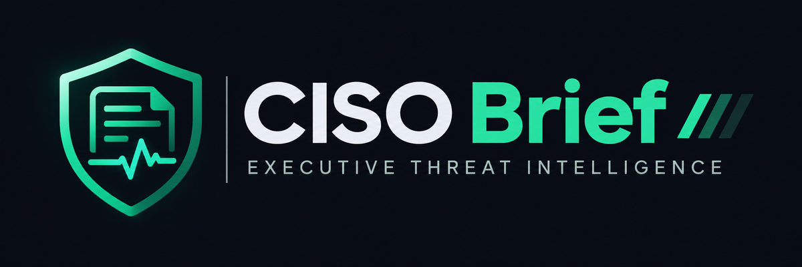
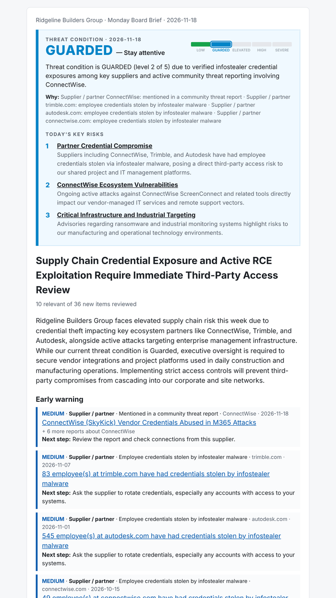
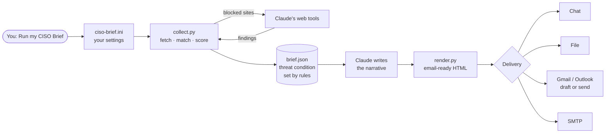

<div align="center">



<h2>CISO Brief: Claude skill</h2>

<p><b>Your threat-intel brief, built by Claude. No server, no Docker, nothing to install.</b></p>

</div>

---

## What it does

Ask Claude *"Run my CISO Brief"* and you get a short, readable briefing on what matters to **your** organization today:

- **Threat condition.** One level from LOW to SEVERE, with the reasons. Fixed rules decide it; Claude never makes it up.
- **Today's key risks.** The top three, each with why it matters to you.
- **Early warning** about your company, your suppliers, your technology and your industry:
  - your company or a supplier named on a ransomware leak site
  - lookalike domains getting TLS certificates (phishing set-up)
  - employees whose passwords were stolen by infostealer malware
  - community threat reports naming you or your industry
  - malware hosted on your or a supplier's domain
  - new CVEs in your technology that are predicted to be exploited soon
  - threat groups known to target your industry that are active in current reporting
- **Immediate actions**, each with an owner and a timeframe, then themes, active attacks and the top items by risk.
- Written for your audience: **executive** (board, plain language) or **technical** (SOC: CVEs, EPSS, patch and detection steps).

Everything comes from free, public sources. API keys are optional, and so is email.

<p align="center"></p>

## How it works



1. **Collect.** `scripts/collect.py` fetches every enabled source, keeps what mentions your names, domains, suppliers, technology or industry (whole words only, so "Okta" never matches "Oktoberfest"), scores risk, and sets the threat condition by fixed rules. It's plain Python using only the standard library, so there's nothing to install.
2. **Fill gaps.** Some Claude environments block outside websites from code. When that happens, Claude fetches the blocked sources with its own web tools and hands the findings back to the script, so the same rules still decide the level. Anything it couldn't check is listed in the brief.
3. **Write.** Claude writes the headline, key risks, summary and actions from the collected data only. It can't change the level, can't add facts, and must call leak-site posts and infostealer counts *claims*.
4. **Render and deliver.** `scripts/render.py` builds an email-ready HTML brief (plus Markdown), then it's delivered the way your settings say.

## Set it up

### 1. Add the skill to Claude

| Where you use Claude | How |
|---|---|
| **Claude app** (web, desktop, mobile) | Download [`ciso-brief.zip`](ciso-brief.zip), then upload it under **Skills** in Claude's settings. |
| **Claude Code** | Copy the [`ciso-brief`](ciso-brief/) folder to `~/.claude/skills/ciso-brief/` (or `.claude/skills/` in a project). |

Skills need code execution turned on in Claude's settings; which plans include skills can change, so check Claude's help center if you don't see the option.

### 2. Tell it about your organization

Say: **"Set up my CISO Brief."** Claude asks for:

- your company name, other names and domains;
- your industry;
- the main technology you run;
- your key suppliers and their domains;
- your audience (executive or technical);
- daily or weekly.

It writes the answers to a settings file, `ciso-brief.ini`. You can also copy [`config.example.ini`](ciso-brief/config.example.ini) to `ciso-brief.ini` and fill it in yourself; every line is commented.

### 3. Run it, or schedule it

- *"Run my CISO Brief."*
- *"Run my CISO Brief every weekday at 7am."* Claude creates a scheduled task.
- *"Run my CISO Brief every Monday at 8am for the board."*

For weekly briefs, set `lookback_days = 7`.

### 4. Optional: free API keys

Each key turns on one more source. Leave any of them blank and that source is skipped; the brief says so.

| Source | What it adds | Where to get the key (free) | Setting |
|---|---|---|---|
| AlienVault OTX | Community threat reports naming you, your suppliers or your industry | [otx.alienvault.com](https://otx.alienvault.com) → Settings → OTX Key | `otx_api_key` |
| abuse.ch URLhaus | Malware served from your or a supplier's domain | [auth.abuse.ch](https://auth.abuse.ch/) → Save profile → Optional → Auth-Key | `abusech_auth_key` |
| NVD | ~10× faster vendor CVE checks (works without a key) | [nvd.nist.gov/developers/request-an-api-key](https://nvd.nist.gov/developers/request-an-api-key) | `nvd_api_key` |

Put them under `[keys]` in `ciso-brief.ini`. Or set environment variables, which take priority over the file: `CISO_BRIEF_OTX_API_KEY`, `CISO_BRIEF_ABUSECH_AUTH_KEY` and `CISO_BRIEF_NVD_API_KEY`.

OTX and URLhaus send the key in a request header. Claude's web tools can't do that, so those two only work where the script itself has internet access (Claude Code, or the desktop app working in a folder on your computer).

### 5. Optional: email

Email is **off** by default; the brief shows up in the chat with an HTML copy saved. To change that, edit `[delivery]`:

| `mode` | `email_method` | What happens |
|---|---|---|
| `chat` (default) | n/a | Summary in the conversation; full brief saved as `brief.html` |
| `file` | n/a | Saved only |
| `email` | `connector` | Claude uses your connected **Gmail or Outlook**. `connector_action = draft` (default) creates a draft for you to review; `send` sends it. |
| `email` | `smtp` | Sent directly over SMTP (Gmail with an [App Password](https://myaccount.google.com/apppasswords), Microsoft 365, any relay). Fill in `[smtp]`; set the password as `CISO_BRIEF_SMTP_PASSWORD` instead of writing it in the file. |

`recipients` is a comma-separated list; leave it blank to send to yourself.

## Sources

| Source | Key | Used for |
|---|---|---|
| [CISA KEV](https://www.cisa.gov/known-exploited-vulnerabilities-catalog) | none | Vulnerabilities confirmed as exploited |
| CISA news, The Hacker News | none | Advisories and current reporting |
| [RansomLook](https://www.ransomlook.io) (CC BY 4.0) | none | Ransomware leak-site posts |
| [crt.sh](https://crt.sh) | none | Lookalike-domain certificates |
| [Hudson Rock](https://www.hudsonrock.com) | none | Infostealer-compromised employees |
| [NVD](https://nvd.nist.gov) + [FIRST EPSS](https://www.first.org/epss/) | optional | New vendor CVEs likely to be exploited |
| [MITRE ATT&CK®](https://attack.mitre.org) | none | Groups that target your industry |
| [AlienVault OTX](https://otx.alienvault.com) | free | Community threat reports |
| [abuse.ch URLhaus](https://urlhaus.abuse.ch) | free | Malware on watched domains |

## The threat condition rules

| Level | Set when |
|---|---|
| 🔴 **SEVERE**: Respond now | Your company is named on a ransomware leak site, or your domain is serving malware |
| 🟠 **HIGH**: Act today | A high-severity signal about your company (lookalike domain, recent infostealer hits, a threat report naming you), active exploitation in your own technology, or a vendor CVE ≥ 50% likely to be exploited |
| 🟡 **ELEVATED**: Heightened vigilance | A supplier on a leak site or hosting malware, an exploited item matching your industry or keywords, or 3+ new KEV entries |
| 🔵 **GUARDED**: Stay attentive | High-risk items in the feeds, or medium signals about you or your suppliers |
| 🟢 **LOW**: Routine monitoring | None of the above |

These are the same rules the Docker app uses, so both give the same answer for the same data.

## Run it without Claude

The scripts work on their own. Without Claude you get the rules-based brief: threat condition, key risks, early warning and items, but no written summary or actions. This is handy for cron or Windows Task Scheduler.

```bash
cd ciso-brief
python3 scripts/collect.py --config ciso-brief.ini --out out/brief.json --state out/state.json --cache-dir out
python3 scripts/render.py  --brief out/brief.json --out-dir out --logo cid
python3 scripts/send_email.py --config ciso-brief.ini --html out/brief.html --text out/brief.md --subject-file out/subject.txt
```

You need Python 3.9 or newer and nothing else. Use `send_email.py --dry-run` to check settings without sending.

## Files

```
ciso-brief/
├── SKILL.md               instructions Claude follows
├── config.example.ini     every setting, commented; copy to ciso-brief.ini
├── scripts/
│   ├── collect.py         fetch, match, score, threat condition → brief.json
│   ├── render.py          brief.json (+ Claude's narrative) → brief.html, brief.md, subject.txt
│   └── send_email.py      optional SMTP sender
├── references/
│   ├── fallback.md        how Claude fills in sources the sandbox blocks
│   └── no-python.md       the full rules, for environments with no code execution
└── assets/logo-email.png
```

## Privacy and safety

- `ciso-brief.ini` can hold API keys and an email password. It's git-ignored here; never commit it or paste it anywhere public.
- Your settings (company, domains, suppliers) are sent to the public sources above as search terms and are processed by Claude.
- Leak-site posts and infostealer counts are third-party claims. The brief labels them that way; confirm before acting on them.
- Email is never sent unless you turn it on, and connector email defaults to drafts.

## Troubleshooting

| Symptom | Fix |
|---|---|
| "Not checked (unreachable)" for most sources | Claude's sandbox blocks those sites. It fills in what it can with web tools. For full coverage, run it from Claude Code or the desktop app working in a local folder. |
| OTX / URLhaus always skipped | Add the free key under `[keys]`, and run where the script has internet access (see step 4) |
| Early warning empty | Add your domains and suppliers. Some sources look back 14–30 days, but a quiet day is normal. |
| SMTP "username/password rejected" | Use a Gmail App Password, not your normal password |
| Wrong company matched | Names shorter than 4 letters are ignored on purpose; use a longer name or the domain |

Part of [CISO Brief](../README.md). For the self-hosted web app with the mailer builder, see the main README.
